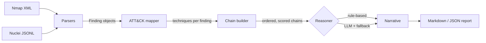

<div align="center">

# 🛡️ Agentic Attack Chain Demonstrator

**Turn raw Nmap + Nuclei output into MITRE ATT&CK-mapped attack-chain reports, with a pluggable reasoning layer (rule-based or LLM).**


</div>

---

## Why this exists

Vulnerability scanners produce long, flat lists. Defenders actually need to know *how weaknesses combine*: an exposed SSH port, a default admin login and an unpatched web server are three separate rows in a scan, but together they describe a path an attacker could follow.

This proof-of-concept explores that idea. It ingests scanner output, maps each finding to [MITRE ATT&CK](https://attack.mitre.org/) techniques, orders them by tactic into a **per-host attack chain**, scores the chain, and writes an analyst-style report with recommended mitigations.

> **Scope:** this is a *defensive triage aid*. It analyses scan results; it contains no exploit code and never attempts exploitation.

## Features

- 🔎 **Parsers** for Nmap XML (`-oX`) and Nuclei JSONL (`-jsonl`) normalised into a common `Finding` model
- 🗺️ **Transparent ATT&CK mapping**: small, readable rule functions in [`mitre.py`](src/attackchain/mitre.py), easy to extend
- ⛓️ **Chain builder** that groups findings per host, orders techniques by tactic and scores multi-stage paths higher than isolated issues
- 🧠 **Pluggable reasoning**: deterministic `RuleBasedReasoner` by default; `LLMReasoner` wraps any `complete(prompt) -> str` function (a hosted API, local Ollama...) with a grounded prompt and automatic fallback if the provider fails
- 📝 **Reports** in Markdown and JSON with technique links and mitigations
- 🔒 **Safe by default**: the optional `scan` command refuses to run without an explicit `--authorized` confirmation
- ✅ **Zero runtime dependencies** and a unit-test suite

## Architecture



| Module | Responsibility |
|---|---|
| `parsers.py` | Normalise scanner output into `Finding` objects |
| `mitre.py` | Heuristic finding → ATT&CK technique rules + mitigations |
| `chains.py` | Group by host, order by tactic, build `AttackChain` |
| `reasoner.py` | `RuleBasedReasoner` and `LLMReasoner` |
| `report.py` | Markdown and JSON rendering |
| `cli.py` | `analyze` and (opt-in) `scan` commands |

## Quick start

```bash
git clone https://github.com/MahakVerma8888/agentic-attack-chain-demonstrator.git
cd agentic-attack-chain-demonstrator
pip install -e .            # or: export PYTHONPATH=src

# Analyse the bundled synthetic sample data
python -m attackchain analyze \
  --nmap samples/nmap_sample.xml \
  --nuclei samples/nuclei_sample.jsonl \
  --out report.md --json report.json
```

The bundled samples describe a **fictional lab host in the RFC 5737 documentation range (`192.0.2.0/24`)**; no real systems are involved.

### Example output

From the sample data ([full report](docs/sample_report.md)):

| Host | Rating | Score | Tactics | Steps |
|---|---|---|---|---|
| 192.0.2.10 | CRITICAL | 38 | initial-access → execution → credential-access → lateral-movement | 7 |
| 192.0.2.20 | LOW | 0 | reconnaissance | 1 |

### Using an LLM for the narrative

```python
from attackchain.cli import analyze
from attackchain.reasoner import LLMReasoner

def complete(prompt: str) -> str:
    ...  # call your provider of choice and return the text

chains = analyze("scan.xml", "nuclei.jsonl", reasoner=LLMReasoner(complete))
```

The prompt instructs the model to use *only* the supplied evidence and not to invent findings or CVEs. No API keys are stored in this repo.

### Scanning your own lab (optional)

```bash
python -m attackchain scan <target> --authorized
```

Requires `nmap` and `nuclei` on your `PATH`. **Only scan systems you own or have written permission to test.**

## Testing

```bash
PYTHONPATH=src python -m unittest discover -s tests -v
```

## Limitations & roadmap

This is a proof-of-concept, and its limits are deliberate to keep the logic auditable:

- ATT&CK mapping is rule-based and covers a small technique subset; it will miss things and can over-approximate.
- Chains are *hypothetical* paths from co-located findings, not validated exploit paths.
- Planned: richer technique catalogue, CVE enrichment (KEV/EPSS), retrieval-augmented remediation guidance, multi-host path correlation, SARIF export.

## Related work

Part of my work on AI-assisted vulnerability analysis alongside team **The ARTIFICES** (Smart India Hackathon 2025 Grand Finalist, NTRO problem statement). See [ai-vulnerability-analysis-platform](https://github.com/MahakVerma8888/ai-vulnerability-analysis-platform).

## License

MIT, see [LICENSE](LICENSE).

---

<div align="center">

Built by [**Mahak Verma**](https://github.com/MahakVerma8888) · [LinkedIn](https://www.linkedin.com/in/mahak-verma-144b00384/)

</div>
